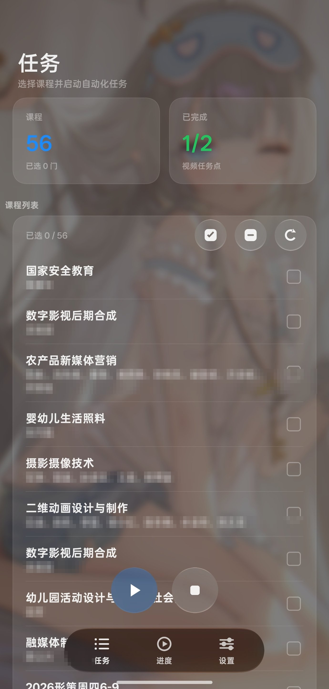

<p align="center">
  
</p>

<h1 align="center">超星AX</h1>

<p align="center">
  <b>面向 Android 的超星视频任务自动化客户端 · COUI 17 界面</b>
</p>

<p align="center">
  登录、拉课程、跑任务点、答测验、进度通知，全部在手机本地完成，不依赖电脑端服务。<br>
  界面按 ColorOS 17 设计规范重写，逻辑层 100% 原生 Java。
</p>

<p align="center">
  <a href="https://github.com/ArmorXzz/chaoxing-ax/releases/latest"></a>
  
  
  
  
</p>

<p align="center">
  <b>简体中文</b> · <a href="https://github.com/ArmorXzz/chaoxing-ax/releases/latest">下载 APK</a> · <a href="#从源码构建">从源码构建</a>
</p>

---

## 截图

<p align="center">
  
</p>

<p align="center">
  <sub>任务页：课程卡片列表 · 圆形全选/全不选/刷新 · 悬浮执行键与底栏（夜间模式）</sub>
</p>

## 界面

整个界面用 [COUI](https://github.com/suqi8/coui)（ColorOS 17 设计语言的 Compose 组件库）搭出来，不是套壳网页：

- **根容器**：`Scaffold` + 悬浮 `FloatingNavigationBar`，页面用 `LazyColumn` + `overScrollVertical` 的橡皮筋回弹
- **卡片**：`SquircleShape` 连续曲率圆角 + 0.8dp 描边，描边跟着按压一起缩，`PressFeedbackType` 走 COUI 原生反馈
- **设置页**：`PreferenceCategory` + `CardListGroup` + `SwitchPreference / SliderPreference / OverlayDropdownPreference`，分割线与行距由组件负责
- **材质**：`rememberLayerBackdrop` + `couiViewBlur` 给底栏与弹层做真材质模糊（Android 13+ 生效，以下自动回退不透明）
- **动效**：底栏切页是 `HorizontalPager` 非线性缓动滑动；二级页有独立入场过渡，并接上 Android 预测式返回（跟手右移、取消回弹）

## 功能

| 模块 | 说明 |
|---|---|
| 账号 | 手机号 + 密码登录（AES-CBC 加密参数），Cookie 与会话只存本机；保存账号快速切换、密码可见小眼睛、自动登录开关 |
| 课程 | 一次拉全量课程，卡片列表逐门勾选（默认全不选），全选 / 全不选 / 刷新 |
| 刷课 | 任务点自动播放并定时上报心跳，可设倍速与并发；国家安全教育课支持循环刷到章节全部完成 |
| 测验 | 读题库页取题，按内置答案库顺序填写，`pyFlag=1` 只保存不提交；单选 / 多选 / 填空 / 判断 / 简答，题干做去噪与多空拆分 |
| 进度 | 按视频合并的进度卡，200ms 补间读秒；失败可在「失败详情」二级页看原因与重试次数 |
| 通知 | 刷课期间通知栏显示实时进度（含每路视频读秒），可直接在通知里停止 |
| 外观 | 浅色 / 深色 / 跟随系统；壁纸、背景模糊强度、材质模糊；桌面图标自适应 |

## 技术栈

| 层 | 选型 |
|---|---|
| 语言 | Kotlin（界面）+ Java（逻辑层） |
| UI | Jetpack Compose 1.11 + COUI 2.0.0（`coui-ui` / `coui-preference` / `coui-icons` / `coui-blur` / `coui-squircle`） |
| 构建 | AGP 9.1 + Gradle 9.3.1 + JDK 21，`compileSdk 37` / `targetSdk 36` / `minSdk 26` |
| 网络 | `HttpURLConnection` + jsoup 解析 HTML |
| 存储 | `SharedPreferences` |
| 签名 | 自己的 keystore（仓库不含任何密钥） |

## 项目结构

<details>
<summary>展开目录</summary>

```
app/src/main/java/com/armx/chaoxing/
├── Crypt.java          AES/CBC 登录参数加密
├── Http.java           Cookie 保持、重定向、超时
├── Html.java           课程 / 章节 / 任务点 / 题目解析
├── Engine.java         刷课主循环（视频心跳、结算、阅读、文档、测验）
├── Work.java           测验作答与答案清洗
├── AnswerBank.java     内置答案库读取与章节匹配
├── CxFont.java         字体反爬（字形 hash → 码位）
├── Model.java          Course / Point / VTask / Question
├── Store.java          本地设置与账号持久化
├── TaskService.java    前台服务 + 通知进度
├── MainActivity.java   容器与生命周期
├── RootScreen.kt       根容器：Scaffold / 底栏 / 二级页 / 预测式返回
├── LoginScreen.kt      登录页
├── TasksScreen.kt      任务页
├── ProgressScreen.kt   进度页 + 失败详情
├── SettingsScreen.kt   设置页（Preference 组件）
├── AnswersScreen.kt    内置答案库
├── Components.kt       共用组件（CxCard / PageTitle / IconPill）
├── CxController.kt     界面状态与业务桥接
├── CxMaterial.kt       材质模糊 provider
├── CxTheme.kt / CxIcons.kt / CxTouch.kt / CxFx.kt / BuildInfo.kt
```

</details>

## 仓库里没有的东西

为了体积与版权，仓库**不包含**：

- `app/src/main/assets/web/icon/bg.jpg`、`bg_mo.jpg`（内置壁纸，插画版权归原作者）
- 任何 keystore / 签名文件、`local.properties`

没有壁纸时应用会退化成纯色背景，功能不受影响。想恢复内置壁纸，放成：

```
app/src/main/assets/web/icon/bg.jpg      # 「夏花」
app/src/main/assets/web/icon/bg_mo.jpg   # 「魔王」
```

建议 1240×1754 以内、JPEG。

## 从源码构建

```bash
# 1. 准备 JDK 21 与 Android SDK（platform 37、build-tools 35+）
#    Gradle 不用装，仓库自带 wrapper（9.3.1）

# 2. 指定 SDK 路径
echo "sdk.dir=/path/to/Android/sdk" > local.properties

# 3. 出包
./gradlew :app:assembleDebug      # 调试包，直接能装
./gradlew :app:assembleRelease    # 正式包
```

`release` 默认**不签名**（仓库不含密钥）。要签自己的包，把 keystore 放成 `app/cx-release.jks`，或用环境变量：

```bash
export CX_KEYSTORE=/abs/path/my.jks
export CX_STORE_PASS=你的口令
export CX_KEY_ALIAS=你的别名
export CX_KEY_PASS=你的口令
```

也可以自己生成一把：

```bash
keytool -genkeypair -v -keystore app/cx-release.jks -alias cx \
        -keyalg RSA -keysize 2048 -validity 10000
```

## 持续集成

`.github/workflows/build.yml` 在每次 push / PR 时用 JDK 21 + SDK 37 跑 `:app:assembleDebug`，产物作为 artifact 上传。因为不含密钥，CI 只出调试包。

## 免责声明

本项目仅供**个人学习与技术研究**使用（Android 逆向、Compose 自定义组件、HTTP 协议分析）。使用本工具刷课可能违反超星学习通的服务条款与所在学校的学术规范，由此产生的一切后果由使用者自行承担。请勿用于商业用途。

## 第三方与许可

- [COUI](https://github.com/suqi8/coui) —— Apache-2.0，界面组件与设计规范来源
- [jsoup](https://jsoup.org/) —— MIT
- 项目本体以 **Apache-2.0** 发布，详见 [`LICENSE`](LICENSE)
